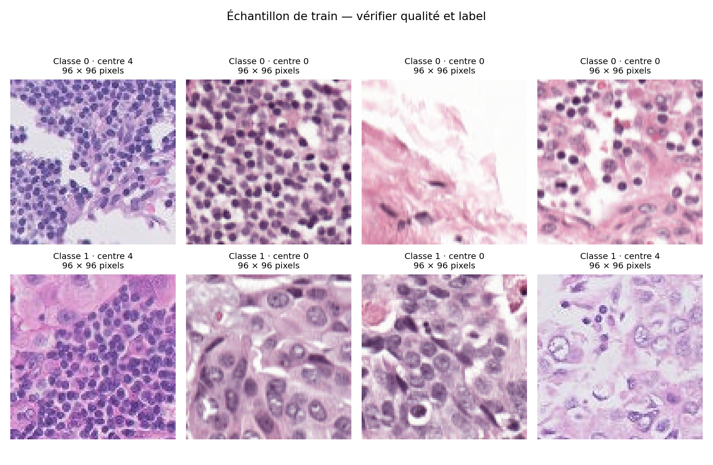
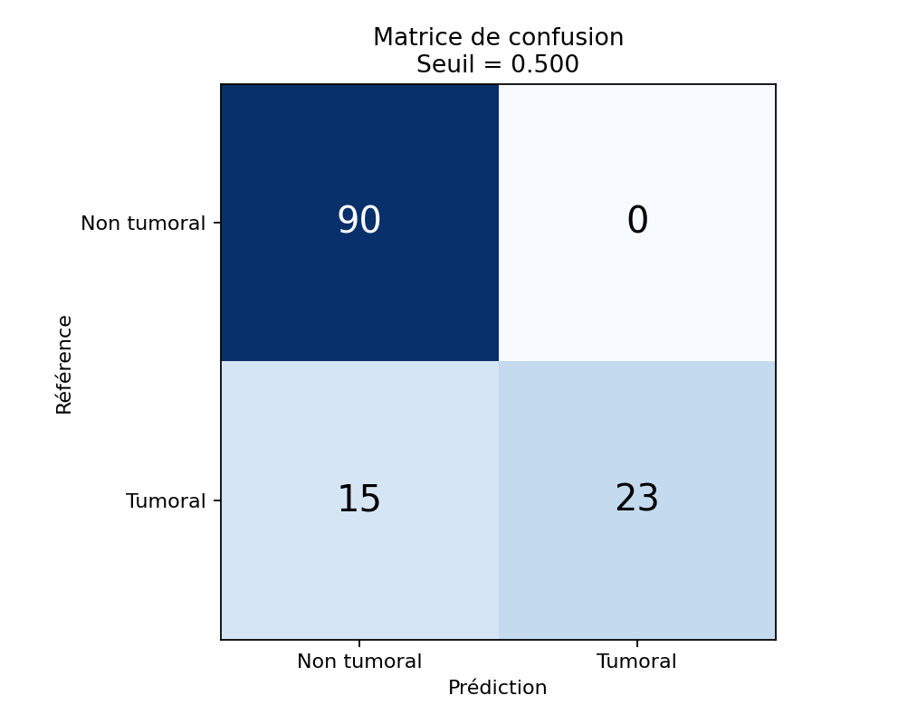
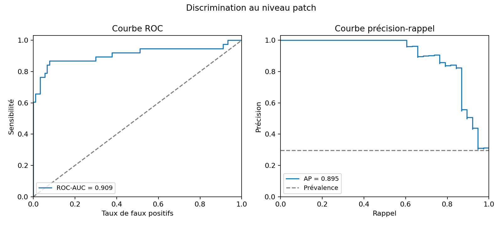
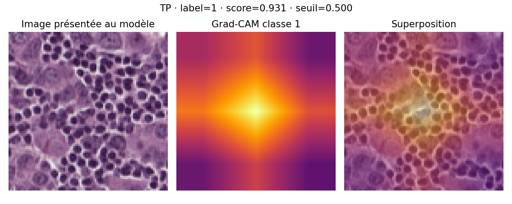
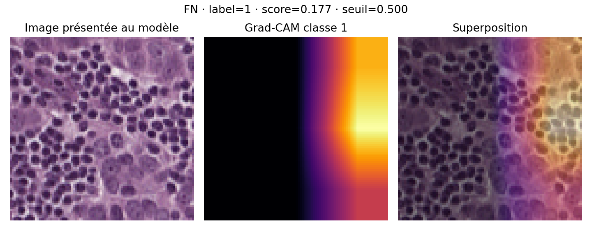
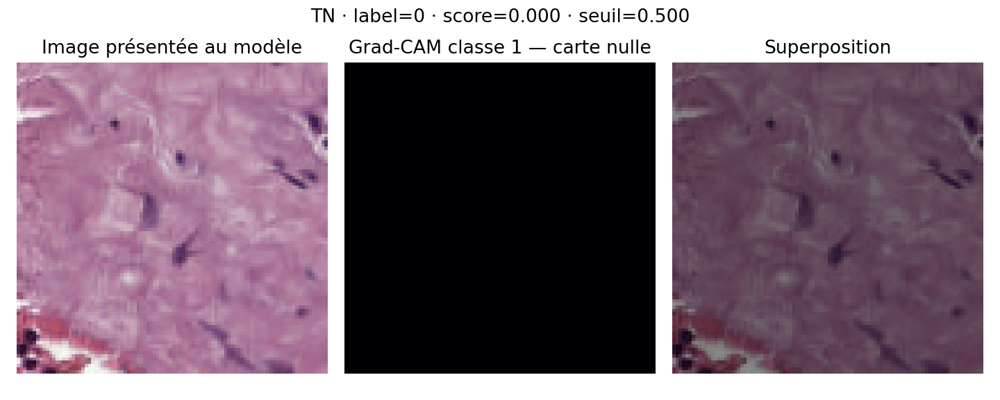

# Premier pilote sur CAMELYON17-WILDS — 6 novembre 2026

**Deux entraînements réels ont été exécutés. Le fine-tuning partiel améliore la validation, mais manque encore 15 patchs tumoraux sur 38 au seuil 0,5. Ce pilote démontre la faisabilité du pipeline ; il ne constitue ni le benchmark complet ni le rendu scientifique final. Aucune prédiction n'a été calculée sur le test.**

## 1. Données et contrôle de la source

Le pilote vient du miroir communautaire `fumiyau/wilds-archive`, révision `f7b0ea1de482b7dcccfd9a15af2825a4e70b335d`. Le lien CodaLab officiel a répondu 404 lors de l'essai. Le miroir reprend le schéma CAMELYON17-WILDS 1.0, mais son identité binaire avec le bundle original indisponible n'est pas démontrée. Les contrôles ci-dessous vérifient la cohérence et l'intégrité des fichiers utilisés ; ils ne transforment pas le miroir en distribution officielle.

Les six ZIP complets représentent **10,768 Go**. Seuls leurs index, les métadonnées et les PNG sélectionnés ont été récupérés par plages HTTP. Les **688 PNG occupent 16,04 Mo**, hors métadonnées et index. La dernière tentative de vérification a transféré 75,48 Mo et réutilisé les 688 images : ce chiffre **n'est pas le trafic total**, car les transferts des tentatives précédentes n'ont pas tous été enregistrés. La latence des nombreuses petites requêtes a dominé la durée d'acquisition.

L'essai réel a révélé deux incompatibilités corrigées : les groupes XML peuvent s'appeler `Tumor`, et les PNG WILDS sont ici en **RGBA**, avec un alpha entièrement opaque. Les images originales sont conservées ; le modèle les convertit en RGB. Une reprise vérifie les métadonnées, le manifeste, la taille et le CRC de chaque PNG avant réutilisation.

Contrôles réussis sur les 688 images : présence des fichiers, lecture 96 × 96, alpha opaque, CRC ZIP, empreintes SHA-256, absence de doublons exacts de fichiers et de pixels RGB. Aucun groupe patient ni aucune lame n'est partagé entre les ensembles retenus. Ces tests ne recherchent pas les quasi-doublons ni les relations biologiques cachées entre les groupes artificiels du challenge.

Preuves : [acquisition](acquisition.json), [qualité](quality.json), [sélection relative](selection_relative.csv), [effectifs source](source_counts.csv) et [effectifs du pilote](counts.csv). La distribution WILDS est décrite sous CC0 dans le code officiel ; le miroir est signalé séparément dans les [sources](../../docs/sources.md).

## 2. Pourquoi exclure `id_val` et comment sélectionner le pilote

Le CSV complet contient 455 954 patchs. Sa validation interne `id_val` partage **26 groupes patient et 30 lames** avec train. Nous excluons ses 33 560 lignes pour respecter notre séparation par groupes, en conservant les train/val/test OOD d'origine sans réaffecter de patch. Il reste 422 394 lignes potentielles. Nous ne réalisons donc pas de comparaison ID/OOD.

La graine 42 fixe le tirage : au plus dix groupes par ensemble/centre, puis seize patchs par groupe, sans utiliser les labels pour choisir les patchs. Le plafond de dix inclut ici tous les groupes disponibles. Un essai initial à deux groupes donnait un test sans positif ; cette lecture des effectifs a motivé l'élargissement. Cette adaptation concerne la faisabilité, pas une validation indépendante du protocole final.

| Ensemble | Centres | Patchs | Négatifs | Positifs | Groupes | Lames |
| --- | --- | ---: | ---: | ---: | ---: | ---: |
| Apprentissage | 0, 3, 4 | 416 | 310 | 106 | 26 | 29 |
| Validation OOD | 1 | 128 | 90 | 38 | 8 | 10 |
| Test OOD | 2 | 144 | 98 | 46 | 9 | 10 |

Total : 688 patchs, 43 groupes, 49 lames. Le test est téléchargé et ses effectifs sont connus, mais il n'a servi à aucun calcul de prédictions, choix de modèle ou réglage de seuil.

Le nombre égal de patchs par groupe change la composition : la validation complète est équilibrée en classes, alors que le pilote compte **29,7 % de positifs** en validation. Il n'est donc pas représentatif du benchmark complet. Prédire toujours négatif donnerait déjà **70,3 % d'accuracy**, avec une sensibilité nulle.

## 3. Exploration visuelle et prétraitement



La planche utilise uniquement train, avec une sélection fixe conservée dans [training_example_selection.csv](training_example_selection.csv). On observe des variations de teinte rose/violette, de densité de structures sombres et de proportion de zones claires. Certains exemples sont peu détaillés à cette résolution. Ces observations ne suffisent pas à identifier une cellule tumorale ou à attribuer une variation au centre hospitalier. La planche ne couvre d'ailleurs pas tous les centres.

Le label WILDS vaut 1 si le carré central de **32 × 32** contient du tissu tumoral, dans un patch **96 × 96**. Nous conservons le cadrage, convertissons en RGB et appliquons la normalisation numérique ImageNet. Il n'y a ni crop aléatoire, ni normalisation de coloration, ni augmentation dans ce pilote. Ce choix réduit les changements simultanés et préserve le sens du label central ; il ne prétend pas être optimal.

## 4. Expériences comparables

Les deux modèles utilisent ResNet18, les mêmes poids `IMAGENET1K_V1`, le même manifeste, une graine 42, un batch de 32, Adam à 0,001, trois époques et une perte non pondérée. La référence apprend uniquement la tête binaire. Le second modèle adapte aussi le dernier bloc, `layer4`. Le déséquilibre est mesuré mais aucune pondération n'est introduite pour isoler cette modification.

Le checkpoint est choisi par l'**Average Precision de validation**, puis la méthode par ce même critère. En cas d'égalité, la référence gelée était prévue. Le seuil 0,5 reste fixe. Les entraînements ont été exécutés sur CPU avec deux threads, depuis le commit `f2a59d4d36f7f557337c26479b96fe712bc8fd58`, avec un arbre Git propre au lancement. Les configurations et environnements exacts sont enregistrés dans chaque sous-dossier.

| Validation, 128 patchs | Référence gelée | Dernier bloc dégelé |
| --- | ---: | ---: |
| Époque du checkpoint choisi | 3 | 2 |
| Average Precision | 0,796 | **0,895** |
| ROC-AUC | 0,823 | 0,909 |
| Sensibilité au seuil 0,5 | 55,3 % | **60,5 %** |
| Spécificité | 95,6 % | 100,0 % |
| Précision | 84,0 % | 100,0 % |
| F1 | 0,667 | 0,754 |
| Accuracy | 83,6 % | 88,3 % |
| TP / FN | 21 / 17 | 23 / 15 |
| TN / FP | 86 / 4 | 90 / 0 |
| Durée des trois époques | 8,8 s | 11,4 s |

Les durées excluent l'acquisition, l'initialisation et les exports. Ce ne sont pas les durées de toute la procédure.

La décision retient le **fine-tuning partiel pour ce pilote**, avec une AP supérieure de 0,099. À son époque 3, l'accuracy monte à 89,8 %, mais l'AP redescend à 0,880 : nous conservons l'époque 2, conformément au critère écrit. Changer de critère après avoir vu les chiffres favoriserait une sélection opportuniste.

Preuves détaillées : [décision](decision.json), [référence](baseline/metrics.json), [fine-tuning](finetune/metrics.json), [historique de référence](baseline/history.csv) et [historique du fine-tuning](finetune/history.csv). Les CSV de prédictions publiés utilisent des chemins relatifs ; leurs empreintes sont recalculées, et les empreintes des sorties d'exécution originales sont également conservées dans les fichiers de provenance.

Les fichiers `environment.txt` sont des relevés informatifs de versions, pas des fichiers d'installation. Une dépendance locale propre au runtime, étrangère au projet, est omise ; l'empreinte du relevé original est conservée. Installer les fichiers `requirements-*.txt` indiqués dans le README.

## 5. Ce que les résultats permettent de dire



Le modèle retenu détecte 23 des 38 patchs positifs et en manque **15, soit 39,5 %**. L'absence de fausse alerte sur les 90 négatifs explique la précision de 100 %. Ce résultat limité à ce petit échantillon ne garantit pas l'absence de faux positifs ailleurs. L'accuracy de 88,3 % masque une sensibilité encore insuffisante pour présenter une détection fiable.



L'AP et la ROC-AUC décrivent le classement des scores sur plusieurs seuils. Elles n'imposent pas une bonne décision au seuil 0,5. Par exemple, sur `patient_039_node_1`, l'unique patch positif est le mieux classé, donnant une AP de 1, mais son score reste sous le seuil : il est manqué. Sur `patient_038_node_2`, les six patchs positifs sont tous manqués par le modèle retenu. Une amélioration globale peut donc coexister avec des échecs locaux.

Nous ne calculons pas d'intervalle qui traiterait 128 patchs comme 128 observations indépendantes : ils proviennent de seulement huit groupes et dix lames. Une seule graine, trois époques et une validation déjà utilisée pour sélectionner le modèle ne démontrent ni la stabilité du gain ni la performance finale sur un centre supplémentaire.

## 6. Grad-CAM : observations et limites

La classe expliquée est toujours la classe tumorale, sur `layer4`. Pour une entrée 96 × 96, la carte native ne comporte que 3 × 3 positions, interpolées pour l'affichage : elle est trop grossière pour tracer les contours d'une lésion. La règle prend le premier chemin trié dans chaque catégorie disponible. Les trois exemples sélectionnés viennent du groupe 020 ; ils ne représentent pas la diversité de la validation. Le modèle retenu n'a aucun FP sur ce lot, donc cette catégorie n'est pas fabriquée.



**TP, score 0,931.** La contribution positive la plus forte se situe près du centre. Cela est compatible spatialement avec un label portant sur le centre du patch, mais nous ne disposons pas ici du masque pixel correspondant : aucun recouvrement tumoral n'est démontré.



**FN, score 0,177.** L'activation est surtout située sur le bord droit, alors que le label de référence est positif. L'image est une erreur malgré une carte colorée. Cette carte ne suffit pas à expliquer la cause de l'erreur ni à identifier les structures impliquées.



**TN, score très proche de zéro.** La carte de la classe tumorale est nulle après le traitement Grad-CAM et ce fait est signalé. Cela décrit cette explication du modèle ; ce n'est pas une preuve clinique d'absence de tumeur. Voir [la sélection exacte](gradcam_selection.csv).

L'[inspection WSI indépendante](../wsi_example/README.md) montre des polygones de référence sur une autre lame, du centre d'entraînement 4. Elle ne valide pas les Grad-CAM ci-dessus, qui viennent du centre 1. Une tentative de correspondance directe entre deux patchs WILDS du groupe 089 et cette lame n'a pas établi une égalité pixel à pixel. Retrouver la convention d'extraction et de coordonnées est nécessaire avant de comparer leurs masques ; nous n'assimilons pas les coordonnées WILDS à des origines de niveau 0 sans preuve.

## 7. Reproduire et poursuivre

Suivre le [guide d'accès et d'entraînement](../../docs/acces_donnees.md). Les commandes produisent les données et les checkpoints localement ; ils ne sont pas inclus dans Git. Pour les figures de validation du modèle retenu :

```bash
python -m src.visualization.report --evaluation outputs/finetune_real_val --out outputs/rapport_validation_real
python -m src.visualization.explain --manifest data/wilds/pilot_download/pilot.csv --checkpoint outputs/finetune_real/best.pt --evaluation outputs/finetune_real_val --out outputs/gradcam_validation_real --per-category 1
```

La prochaine phase doit fixer une cohorte d'apprentissage plus large et justifiée, vérifier la source et les conventions spatiales, reproduire les expériences avec plusieurs graines, décider d'une éventuelle règle de seuil sur validation, puis figer le protocole avant le test. Le niveau pN reste à clarifier avec l'enseignante : aucune prédiction de stade patiente n'est produite ici.

Le groupe doit relire les exemples et reproduire le pilote sur son matériel. Les calculs et leur première interprétation ont été préparés avec l'assistance de Codex ; ils ne sont pas attribués fictivement à des membres du groupe. Le rapport de 15 pages et la soutenance restent à finaliser.
