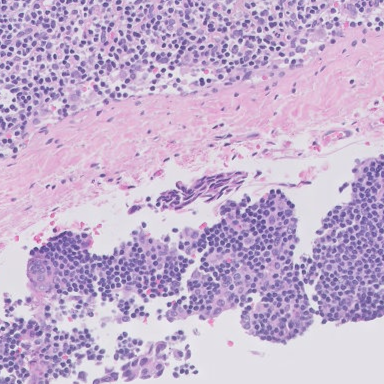
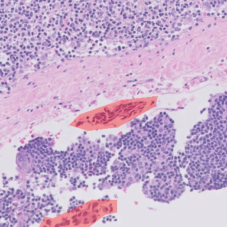

# Inspection d'une lame CAMELYON17 réelle

**Statut : contrôle de lecture et d'alignement, sans validation clinique.** Les fichiers originaux ne sont pas inclus dans Git. Le [guide d'accès](../../docs/acces_donnees.md) permet de les récupérer et de reproduire les exports.

La paire `patient_089_node_3.tif` / `.xml` provient du stockage public CAMELYON sur AWS. Les MD5 des deux fichiers correspondent aux références de la distribution ; les liens, tailles et SHA-256 sont conservés dans [acquisition.json](acquisition.json). L'extraction utilise OpenSlide Python 1.4.7 et openslide-bin 4.0.1.2.

## Ce qui a été vérifié

La lame s'ouvre à 152 064 × 66 048 pixels, possède dix niveaux de résolution et indique 0,25 µm/pixel au niveau 0. Le XML contient sept polygones du groupe `Tumor`. Le lecteur initial acceptait `metastases` et `normal`, mais refusait cet alias réel : ce problème a été corrigé et couvert par un test.

Trois régions de 384 × 384 pixels sont extraites au niveau 2, facteur 4. Leurs coordonnées restent exprimées au niveau 0. Les centres sont calculés à partir des boîtes englobantes des annotations 0, 1 et 3 ; le prélèvement est donc volontairement dirigé vers des zones annotées.

| Origine x, y au niveau 0 | Surface couverte par les polygones dans la région |
| --- | ---: |
| 94 819 ; 12 398 | 4,05 % |
| 99 941 ; 40 529 | 5,51 % |
| 102 268 ; 52 851 | 1,65 % |

Les valeurs exactes se trouvent dans [inspection.csv](inspection.csv). Une région qui contient une annotation peut avoir une très petite proportion de pixels annotés. **Un seuil arbitraire de 10 % aurait déclaré ces trois régions négatives**, malgré la présence de polygones tumoraux. Cela montre pourquoi la définition du label doit être justifiée avant l'extraction. Ce calcul sur l'ensemble de la région ne reproduit pas le label WILDS, qui porte sur le carré central de 32 × 32.

## Exemple inspecté

Région à l'origine 99 941 ; 40 529, avant superposition :

Même région, polygones du XML colorés en rouge :

Les plages rouges apparaissent sur des structures tissulaires et restent localisées ; aucun décalage global évident n'est visible sur cet exemple. Cette observation est un contrôle visuel de coordonnées. Elle ne certifie ni la précision des contours ni la nature histologique des cellules. La miniature annotée a également été examinée ; une relecture par le groupe reste nécessaire.

Ces masques viennent des **annotations fournies**, pas d'une prédiction du CNN ou de Grad-CAM. Les trois régions ne constituent pas un jeu d'évaluation représentatif. L'absence de masque ailleurs ne prouve pas l'absence de toute lésion, notamment pour des cellules tumorales isolées non exhaustivement annotées.

Source et attribution : CAMELYON17, Bandi et al. (2019), distribution publique référencée dans [les sources du projet](../../docs/sources.md). Les deux PNG ci-dessus sont des extraits choisis pour expliquer le contrôle ; la lame complète reste hors Git.
